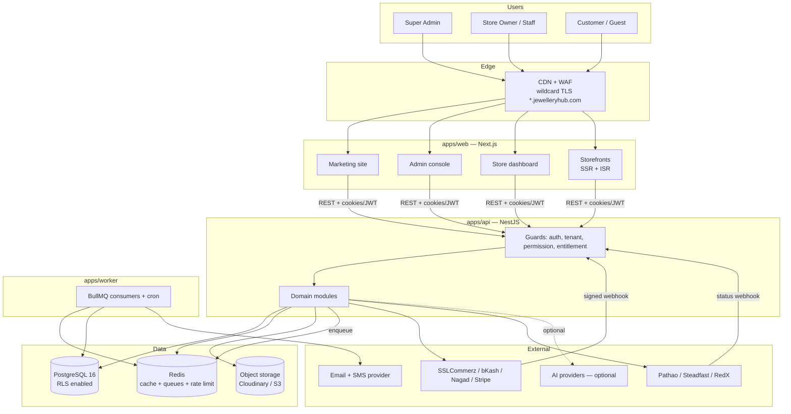
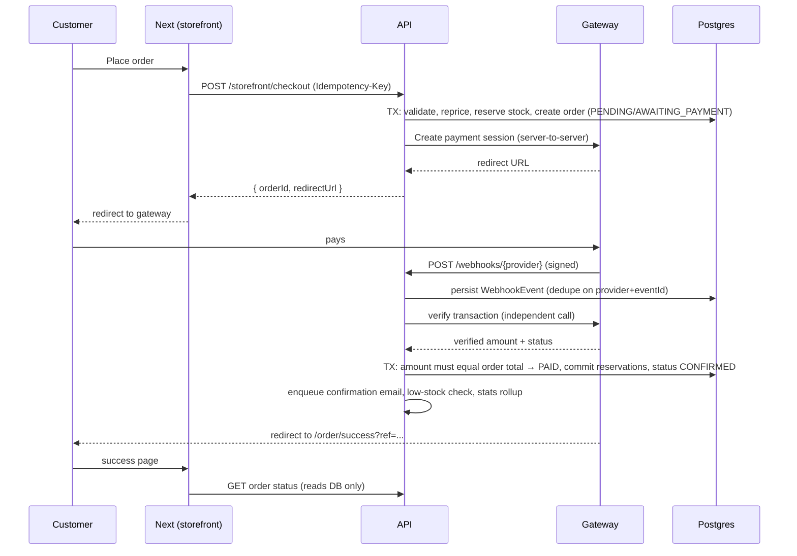
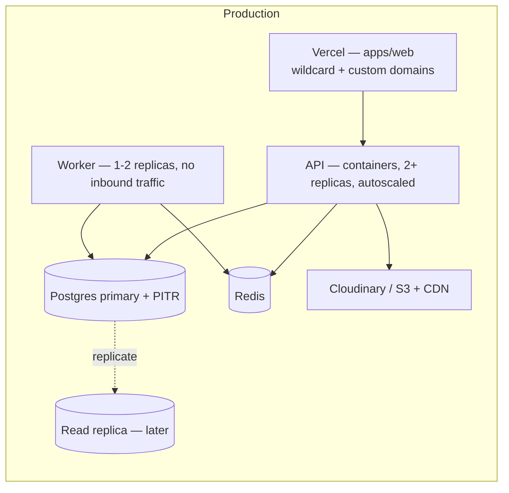

# System Architecture — JewelleryHub

**Version** 0.1 (planning) · **Date** 2026-11-07

---

## 1. Shape of the system

A **monorepo** with two deployable applications and shared packages:

| Deployable    | Stack                      | Hosts                                                           |
| ------------- | -------------------------- | --------------------------------------------------------------- |
| `apps/web`    | Next.js (App Router)       | marketing site, admin console, store dashboard, all storefronts |
| `apps/api`    | NestJS REST                | all business logic, the only writer to Postgres                 |
| `apps/worker` | NestJS standalone + BullMQ | scheduled jobs and async work                                   |

`apps/web` never talks to Postgres. Server Components and Route Handlers call
the API over HTTP with the caller's credentials forwarded. That single rule is
what makes tenant isolation testable: there is exactly one enforcement point.

### Why Next.js _and_ NestJS

The stack was specified, and the split earns its keep: storefronts need
SSR/ISR, image optimisation and edge-cached HTML (Next.js is strong there),
while billing, inventory ledgers, payment webhooks and cron need long-lived
server processes, DI, queues and transaction control (NestJS is strong there).
The cost is one network hop and shared DTO types — paid for by
`packages/shared`, which both sides import, so a contract change breaks the
build rather than production.

## 2. Context diagram



## 3. Request paths

### 3.1 Storefront page

```
browser → CDN → Next middleware (resolve host → storeId, inject x-store-id)
        → Server Component → API GET /storefront/* (public, cached)
        → Postgres (RLS session var set to storeId)
        → HTML streamed back, ISR-cached per host+path, tag-invalidated on publish
```

### 3.2 Dashboard mutation

```
browser → Next Route Handler (attaches access token + active store)
        → API: AuthGuard → TenantGuard → PermissionGuard → EntitlementGuard
        → Service (transaction) → Prisma (tenant-scoped extension) → Postgres
        → ActivityLog + domain event → BullMQ → worker side-effects
```

### 3.3 Payment confirmation (the one that must never be wrong)



The browser redirect is presentation only. Payment status changes come from the
webhook plus an independent verification call, with the amount checked against
the order total. A forged callback therefore changes nothing.

## 4. Layering inside the API

```
HTTP layer      Controller — routing, DTO validation (Zod), Swagger, HTTP codes
                     ↓ only DTOs cross this line
Application     Service — use cases, transactions, authorisation decisions,
                          domain events; no Prisma types in its signatures
                     ↓
Domain          Pure functions and policies: pricing, coupon maths, order state
                machine, entitlement evaluation. No I/O → trivially unit-tested.
                     ↓
Infrastructure  Repositories (Prisma), provider adapters (payment, courier,
                storage, mail, AI), cache, queue
```

Rules: controllers never touch Prisma; domain code never imports Nest; every
external system is reached through an interface defined in the domain and
implemented in infrastructure, so it can be faked in tests.

## 5. Cross-cutting concerns

| Concern        | Mechanism                                                                                                                                                                                                       |
| -------------- | --------------------------------------------------------------------------------------------------------------------------------------------------------------------------------------------------------------- |
| Tenant scoping | `TenantContext` (AsyncLocalStorage) + Prisma client extension + `SET LOCAL app.current_store_id` per transaction, enforced by RLS. See `docs/03-multi-tenancy.md`.                                              |
| Validation     | Zod schemas in `packages/shared`, used by a Nest pipe server-side and by react-hook-form client-side — one definition, both sides.                                                                              |
| Errors         | Every failure becomes `{ error: { code, message, details?, requestId } }`. Codes are a shared enum; the UI maps them to toasts. Unexpected errors are logged with the request id and returned as a generic 500. |
| Idempotency    | `Idempotency-Key` header on checkout, payment init and refunds; the key is stored with the resulting resource id and replayed rather than re-executed.                                                          |
| Caching        | Redis for storefront catalogue reads, entitlement lookups, store-by-host resolution and rate limits. Next ISR for storefront HTML, invalidated by cache tag on publish/price/stock change.                      |
| Queues         | BullMQ: email/SMS, image post-processing, stats rollups, reservation expiry, dunning, renewals, courier polling, webhook retries, CSV import/export. Jobs are idempotent and retried with backoff.              |
| Scheduling     | Cron in `apps/worker`: reservation sweep (1 min), renewals + dunning (hourly), rollups (hourly incremental, nightly full), trial reminders (daily), abandoned-cart email (hourly), domain verification retry.   |
| Audit          | A Nest interceptor on mutating routes writes `ActivityLog` with actor, resource, before/after and request id.                                                                                                   |
| Secrets        | Only from the environment / secret manager. Per-store gateway credentials are envelope-encrypted with a KMS data key and never leave the API.                                                                   |
| Observability  | pino structured logs (requestId, storeId, userId), OpenTelemetry traces, Prometheus-style metrics, Sentry for errors.                                                                                           |
| Rate limiting  | Redis sliding window: auth 5/min/IP, checkout 10/min/session, public catalogue 120/min/IP, webhooks 300/min/provider.                                                                                           |

## 6. Data layer

- **PostgreSQL 16** — single database, shared schema, `storeId` discriminator,
  row-level security. Rationale and alternatives in `docs/03-multi-tenancy.md`.
- **Read scaling** — one primary; a read replica is added when needed, with
  storefront reads routed to it (dashboard stays on the primary to avoid
  read-after-write surprises).
- **Search** — Postgres full-text (`tsvector` + GIN, trigram for fuzzy) for
  v1. The search interface is isolated so a move to Meilisearch/Typesense
  needs no change to callers.
- **Money** — `DECIMAL(14,2)`; Prisma `Decimal` (decimal.js) in application
  code; floats are banned in pricing by lint rule.
- **Migrations** — `prisma migrate`, forward-only, reviewed. Expand/contract
  for breaking changes: add column → backfill job → switch reads → drop.
  Partial unique indexes, CHECK constraints and RLS policies live in
  hand-edited migration SQL since Prisma cannot express them.

## 7. Storefront theming

A theme is **code**, not database rows: a React component set plus a token
schema. The database stores only which theme a store uses, its token overrides,
and the page/section tree.

```
Theme (code)            → components + token schema + supported section types
StoreTheme (db)         → tokens overriding theme defaults, optional custom CSS
StorePage (db)          → one page
StorePageSection (db)   → { type: "hero", position: 0, settings: {...} }
Section registry (code) → type → { component, Zod schema, editor controls }
```

Rendering walks the section rows and renders the registered component with
validated settings. Tokens become CSS custom properties on the store's root,
so brand colours need no rebuild. An unknown section type renders nothing in
production and a warning in the editor, so removing a section type is safe.

## 8. Payment and courier abstraction

```ts
interface PaymentProvider {
  readonly key: PaymentProviderKey;
  createSession(input: CreateSessionInput): Promise<PaymentSession>;
  verify(ref: string, ctx: ProviderContext): Promise<VerifiedPayment>;
  parseWebhook(req: RawWebhook): Promise<WebhookParseResult>; // verifies signature
  refund?(input: RefundInput): Promise<RefundResult>;
  capabilities(): ProviderCapabilities; // refunds? partial? redirect vs inline
}
```

Order code depends only on this interface and on `ProviderCapabilities`, so the
UI can hide a refund button for a provider that cannot refund without a
conditional anywhere in the domain. COD is a provider too — it simply reports
"no online capture", which removes every special case from checkout. Couriers
follow the same pattern (`createConsignment`, `track`, `parseWebhook`,
`cancel?`).

## 9. Deployment topology (summary)

Detail in `docs/10-deployment.md`.



Environments: `local` → `preview` (per PR, ephemeral DB branch) → `staging`
(production-shaped, sandbox gateways) → `production`.

## 10. Architecture decisions

| #   | Decision                             | Alternative rejected                         | Why                                                                                                                          |
| --- | ------------------------------------ | -------------------------------------------- | ---------------------------------------------------------------------------------------------------------------------------- |
| 1   | Shared schema + `storeId` + RLS      | Schema-per-tenant                            | Thousands of schemas make migrations and connection pooling untenable; RLS gives database-level isolation without that cost. |
| 2   | Separate Next.js and NestJS apps     | Next-only with Route Handlers                | Needs queues, cron, long transactions, webhook workers and a single enforcement point for tenancy.                           |
| 3   | Next.js owns all storefronts         | A rendering service per store                | One codebase, one deploy; stores differ by data and tokens, not code.                                                        |
| 4   | Entitlements as rows                 | Boolean columns per feature                  | New limits must be configurable by Super Admin without a migration.                                                          |
| 5   | Theme = code, layout = data          | Full visual page builder with arbitrary HTML | Keeps output premium and secure; arbitrary HTML invites XSS and ugly stores.                                                 |
| 6   | Price locked on the subscription row | Always read the plan's current price         | Raising a price must not silently re-bill existing customers.                                                                |
| 7   | Snapshot order lines and addresses   | Join to live product/address                 | An invoice must be reproducible years later.                                                                                 |
| 8   | Two payment tables                   | One polymorphic table                        | Platform money and store money have different isolation rules and different auditors.                                        |
| 9   | Customer identity scoped per store   | One global customer identity                 | Stores must not learn each other's customer lists; the same person is two rows by design.                                    |
| 10  | Postgres FTS before a search engine  | Meilisearch from day one                     | One fewer system to run; the interface keeps the upgrade cheap.                                                              |
| 11  | Rollup tables for analytics          | Live aggregation                             | Dashboards must stay fast at 500k orders per store.                                                                          |
| 12  | Reserve stock at order placement     | Decrement at payment                         | Prevents overselling during the payment window, which is exactly when it happens.                                            |
