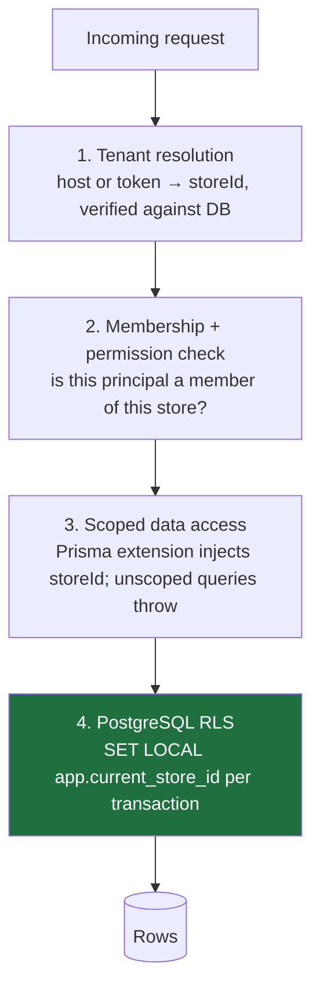

# Multi-Tenant Architecture — JewelleryHub

**Version** 0.1 (planning) · **Date** 2026-11-07

This is the document to get right. Everything else is recoverable; a tenant
leak is not.

---

## 1. Model chosen

**Single database, shared schema, `storeId` discriminator, with PostgreSQL
row-level security as an independent second layer.**

| Option                            | Isolation                               | Migration cost at 1,000 tenants                                    | Pooling   | Verdict    |
| --------------------------------- | --------------------------------------- | ------------------------------------------------------------------ | --------- | ---------- |
| Database per tenant               | Strongest                               | 1,000 migration runs, 1,000 connection pools                       | Terrible  | Rejected   |
| Schema per tenant                 | Strong                                  | 1,000 × N tables per migration; Prisma needs one client per schema | Poor      | Rejected   |
| **Shared schema + RLS**           | Strong _if enforced in two places_      | One migration                                                      | Excellent | **Chosen** |
| Shared schema, app filtering only | Weak — one forgotten `where` leaks data | One migration                                                      | Excellent | Rejected   |

The chosen model's known weakness is the single forgotten `where` clause. The
answer is not discipline; it is that application code **cannot** express an
unscoped query, and that the database rejects one even if it did.

An Enterprise tenant that genuinely requires physical separation can later be
moved to a dedicated database: the code only ever addresses one store at a
time, so this becomes a routing concern, not a rewrite.

## 2. Tenant vs Store

```
Tenant  — the billing entity. Owns subscription, invoices, payment history.
  └── Store — one storefront: catalogue, orders, customers, theme, settings.
```

One store per tenant in v1. Keeping them separate now means multi-storefront
Enterprise plans later cost a feature flag, not a migration. All operational
data hangs off `storeId`; all billing data hangs off `tenantId`.

## 3. The four layers of enforcement



A leak requires all four layers to fail at once.

### Layer 1 — Tenant resolution

Three principals, three resolution rules:

| Principal                     | Source of `storeId`                                                                      | Verification                                                                             |
| ----------------------------- | ---------------------------------------------------------------------------------------- | ---------------------------------------------------------------------------------------- |
| Storefront visitor            | `Host` header → `StoreDomain.hostname`                                                   | Must exist, be verified, store `ACTIVE`; cached in Redis 60 s with explicit invalidation |
| Dashboard user                | `activeStoreId` claim in the access token, cross-checked against the `X-Store-Id` header | Must have a non-deleted, `ACTIVE` `StoreMember` row                                      |
| Super Admin acting on a store | Explicit path parameter                                                                  | Requires a platform permission; every access is audit-logged                             |

The client never supplies a bare `storeId` that is trusted. For dashboard
calls, a mismatch between header and token is a 403, not a silent preference —
that asymmetry is what catches a tampered header.

`middleware.ts` in Next.js maps the host to a store slug and rewrites to the
storefront route group; it passes the resolved host through, and the **API**
resolves and verifies it again. The edge never decides authorisation.

### Layer 2 — Membership and permission

```ts
// Conceptually, per request:
const ctx: TenantContext = {
  storeId, // verified in layer 1
  tenantId,
  principal: { type: 'USER' | 'CUSTOMER' | 'SUPER_ADMIN' | 'API_KEY', id },
  permissions: Set<string>, // effective: role ∪ ALLOW − DENY
  entitlements: EntitlementMap, // plan limits/features, cached
  requestId,
};
```

Held in `AsyncLocalStorage` for the request's lifetime, so no service needs a
`storeId` parameter threaded through it — and so no service can accidentally
use a different one.

Effective permissions = role permissions ∪ member ALLOW overrides − member
DENY overrides. DENY always wins. Owners implicitly hold every store
permission. Super Admins hold platform permissions only, and act on a store
through explicitly audited endpoints.

### Layer 3 — Scoped data access (Prisma client extension)

```ts
export const tenantScoped = (storeId: string) =>
  prisma.$extends({
    name: 'tenant-scope',
    query: {
      $allModels: {
        async $allOperations({ model, operation, args, query }) {
          if (!TENANT_OWNED.has(model)) return query(args); // platform tables
          if (READ_OPS.has(operation)) {
            args.where = { ...(args.where ?? {}), storeId }; // force the filter
          } else if (CREATE_OPS.has(operation)) {
            args.data = injectStoreId(args.data, storeId); // force the column
          } else if (WRITE_OPS.has(operation)) {
            args.where = { ...(args.where ?? {}), storeId }; // scope updates/deletes
          }
          return query(args);
        },
      },
    },
  });
```

Rules that make this airtight rather than decorative:

- `TENANT_OWNED` is **generated** from the schema at build time: every model
  with a `storeId` field is in the set. A new tenant-owned model is protected
  the day it is added, and a model that looks tenant-owned but has no
  `storeId` fails the build.
- Repositories receive the scoped client by injection. The raw client is
  exported from one module, which an ESLint `no-restricted-imports` rule
  forbids everywhere except the tenancy module, the migration runner and the
  seed script.
- Raw SQL goes through a helper that requires an explicit store predicate;
  `$queryRawUnsafe` is banned by lint.
- Cross-store joins are impossible by construction, because every query starts
  from a scoped client bound to exactly one store.

### Layer 4 — PostgreSQL row-level security

**Implemented.** Generated by [`prisma/rls/generate.ts`](../prisma/rls/generate.ts)
into [`prisma/rls/policies.sql`](../prisma/rls/policies.sql) and applied by
migration `20261107090100_constraints_search_rls`. Verified against a live
database by [`prisma/rls/verify.ts`](../prisma/rls/verify.ts) (`pnpm db:verify-rls`).

Application code can be wrong. The database should not be.

```sql
-- One policy per tenant-owned table (generated, never hand-written):
ALTER TABLE "Product" ENABLE ROW LEVEL SECURITY;
ALTER TABLE "Product" FORCE ROW LEVEL SECURITY;   -- applies to the table owner too

CREATE POLICY product_isolation ON "Product"
  USING      ("storeId" = current_setting('app.current_store_id', true))
  WITH CHECK ("storeId" = current_setting('app.current_store_id', true));
```

#### Three roles, not one

The original plan had the API connect as a single non-owner role. Implementation
replaced that with three roles entered per transaction, because a single role
cannot express "this request may read every store" without also granting it to
every request:

| Role           | BYPASSRLS | Granted                                                                                                                              | Used by                                                                   |
| -------------- | --------- | ------------------------------------------------------------------------------------------------------------------------------------ | ------------------------------------------------------------------------- |
| `app_runtime`  | no        | every table except `Session` and `VerificationToken`; read-only on platform catalogues                                               | all tenant requests                                                       |
| `app_identity` | yes       | **only** the 19 tables needed before a tenant context exists — login, token rotation, host → store routing, membership, entitlements | auth and tenant resolution                                                |
| `app_platform` | yes       | everything                                                                                                                           | Super Admin endpoints and rollup jobs, behind a platform permission guard |

`app_identity` is the interesting one. Login has to work before any store is
known, and a customer session row carries no usable store context, so that code
needs to bypass RLS. Giving it a role with **no privilege at all** on `Product`,
`Order` or `Customer` means a bug in auth code cannot reach merchandise or
customer data — isolation by privilege where isolation by row is impossible.
The verifier asserts exactly that.

Every unit of work therefore begins:

```sql
BEGIN;
  SET LOCAL ROLE app_runtime;                     -- loses BYPASSRLS
  SET LOCAL app.current_store_id = '<storeId>';
  ...
COMMIT;                                           -- both settings expire
```

`SET LOCAL ROLE` is deliberate rather than relying only on the connection's
role: isolation then holds even if a connection string is ever misconfigured
with an owning role, and it works on managed providers that hand out a single
login. Both settings are transaction-scoped, so a pooled connection cannot
carry one store's context into another store's query.

`current_setting(..., true)` returns NULL when unset, and `storeId = NULL`
matches nothing — a query that escapes the extension returns **zero rows**
rather than everything. Fail closed. The verifier checks this directly.

#### Child tables are isolated through their parent

19 tables carry no tenant column of their own — join tables and line items such
as `ProductGemstone`, `OrderItem`'s siblings, `InvoiceLine`,
`PurchaseOrderItem`. Rather than denormalising `storeId` onto all of them, their
policy tests that the **parent row is visible**:

```sql
CREATE POLICY product_gemstone_isolation ON "ProductGemstone"
  USING (EXISTS (SELECT 1 FROM "Product" p WHERE p."id" = "ProductGemstone"."productId"));
```

A policy's subquery is itself subject to the parent's policy for the same role,
so isolation composes: the child is visible exactly when its parent is. The
generator refuses to emit a child policy whose parent has no policy of its own,
so the chain cannot be broken by accident.

#### Coverage is enforced, not reviewed

`generate.ts` sorts every model into exactly one bucket — store-scoped,
tenant-scoped, child-of-parent, root (`Store`/`Tenant`), or an explicitly
listed platform table **with a stated reason** — and throws if a model fits
none. It caught a genuinely unclassified table (`PurchaseOrderItem`) the first
time it ran. Current coverage:

| Bucket                            | Tables |
| --------------------------------- | ------ |
| Store-scoped (`storeId`)          | 51     |
| Tenant-scoped (`tenantId`)        | 3      |
| Isolated via parent               | 19     |
| Roots (`Store`, `Tenant`)         | 2      |
| **Protected total**               | **75** |
| No policy, by documented decision | 13     |
| Total models                      | 88     |

The 13 exempt tables are platform-level with no tenant dimension: `User`,
`Session`, `VerificationToken`, `Role`, `Permission`, `RolePermission`,
`PlatformRoleAssignment`, `Theme`, `SubscriptionPlan`, `PlanEntitlement`,
`PlatformSetting`, `PlatformDailyStat`, `WebhookEvent`. Each carries its reason
in the generator, and the verifier asserts that this list is _exactly_ the set
of tables without row-level security — so a table cannot quietly join it.

## 4. Pooling, and why `SET LOCAL` matters

With PgBouncer in transaction mode a connection is shared between tenants
between transactions. Therefore:

- Every tenant-scoped read or write runs **inside** a transaction (Prisma
  interactive transaction), opened by a helper that sets the context first.
- `SET LOCAL` (never `SET`) so the value dies with the transaction.
- Prisma's prepared statements require `pgbouncer=true` in the connection
  string for transaction-mode pooling.
- A connection returned to the pool is asserted clean in development: a debug
  hook checks `current_setting('app.current_store_id', true) IS NULL` after
  release.

## 5. Caching without cross-tenant bleed

Every cache key is prefixed with the store id, and the prefix is added by the
cache wrapper, not by callers:

```
store:<storeId>:product:<slug>
store:<storeId>:collection:<slug>:page:<n>
host:<hostname>            → { storeId, status }   (platform-level, 60 s)
entitlements:<tenantId>    → EntitlementMap        (5 min, invalidated on plan change)
```

Next.js ISR caches are tagged `store-<storeId>` plus a resource tag, so
publishing a theme or changing a price revalidates only that store's pages.
Image CDN paths include the store id. No cache object is ever keyed by slug
alone, because slugs collide across stores by design.

## 6. Subdomains and custom domains

```
jewelleryhub.com            → marketing
app.jewelleryhub.com        → store dashboard
admin.jewelleryhub.com      → platform console
<slug>.jewelleryhub.com     → storefront (wildcard TLS, created on signup)
www.brand.com               → storefront (custom domain, verified + on-demand TLS)
```

Reserved slugs (`www`, `app`, `admin`, `api`, `cdn`, `static`, `mail`, `blog`,
`help`, `status`, `assets`, `my`, `shop`, `store`, plus a profanity list) are
rejected at signup from a single shared constant.

Custom domain flow: add hostname → show DNS target and `TXT` verification
token → poll until verified → request certificate → mark `ISSUED` → optionally
redirect the subdomain to it. Unverified hostnames never resolve to a store.

## 7. Entitlement enforcement

Plan limits are tenancy's sibling: both are server-side gates.

```ts
@Post('products')
@RequirePermission('product:write')
@RequireLimit('max_products', { count: ctx => ctx.storeProductCount })
create(@Body() dto: CreateProductDto) { ... }
```

- The guard reads the effective entitlement map (plan entitlements overlaid
  with subscription overrides, cached per tenant) and compares it against a
  live count — counted in the same transaction as the insert, so two parallel
  creates cannot both pass the boundary.
- Exceeding a limit returns `402 PAYMENT_REQUIRED` with
  `{ code: 'PLAN_LIMIT_EXCEEDED', limit, current, upgradeTo }`, which the UI
  turns into an upgrade prompt.
- Feature entitlements gate whole routes (`custom_domain`, `staff_accounts`,
  `advanced_reports`) and are also used to hide UI — but the gate is the guard.
- Downgrade is a precondition check: if current usage exceeds the target plan,
  the API refuses and names what must be removed.

## 8. Super Admin access to tenant data

Support needs occasional access; tenants deserve to know about it.

- Super Admin endpoints that read tenant data take the store id explicitly and
  require a platform permission (`platform:store:read`).
- Impersonation issues a short-lived token (15 min) marked
  `impersonatedBy: <userId>`. The dashboard shows a persistent banner, writes
  are blocked unless `platform:store:write` is held, and both start and end are
  audit-logged with a reason.
- RLS context is set to the target store for the duration, so even impersonated
  access cannot reach a third store.

## 9. How this gets verified

Isolation is tested as a property of the system, not reviewed by eye.

**Already implemented** — `pnpm db:verify-rls`, 32 checks against a live
database with the application bypassed entirely (29 pass locally, 3 skipped on
the WASM dev server — see §11):

1. **Role properties** — `app_runtime` is neither superuser nor `BYPASSRLS`;
   the other two roles are exactly as intended.
2. **Coverage** — every one of the 75 tenant-owned tables has
   `ENABLE` + `FORCE` row-level security and at least one policy, and the set of
   tables _without_ RLS equals the documented exempt list exactly.
3. **Fail closed** — with no context set, tenant tables return zero rows.
4. **Read isolation** — store A sees only its own rows, including by direct
   primary key, and including child tables with no `storeId` of their own.
5. **Write isolation** — inserting into another store is rejected by
   `WITH CHECK`; moving a row to another store is rejected; updates and deletes
   aimed at a foreign row affect nothing and the row survives.
6. **Least privilege** — `app_runtime` is denied `Session` outright and cannot
   write the plan catalogue; `app_identity` can read `Session` but is denied
   `Product` and `Order`.
7. **No context leak** — after the transaction ends, both the role and the
   store context are gone, which is what makes connection pooling safe.
8. **Platform mode** — sees every store, but only when explicitly entered.
9. **Drift** — `pnpm db:rls -- --check` fails if the generated policies no
   longer match `schema.prisma`; CI runs it as a required check.

**Still to come**, in the phases that introduce the API:

10. **Contract test, generated** — for every tenant-owned route in the OpenAPI
    document, a test creates the resource as store A, then calls the same route
    with store B's credentials and asserts 404/403 and an empty body. A new
    endpoint without this coverage fails CI.
11. **Pool-bleed test** — interleaved concurrent requests for two stores over a
    small connection pool; asserts no response contains the other store's ids.
12. **Lint gates** — already configured in
    [`packages/config/eslint.nest.js`](../packages/config/eslint.nest.js): no
    raw Prisma client or `pg` import outside `core/database`, no
    `$queryRawUnsafe` / `$executeRawUnsafe`, no repository import from a
    controller, and no framework or I/O import inside the pure pricing and
    order-state-machine modules.

## 10. Residual risks

| Risk                                  | Mitigation                                                                                                                 |
| ------------------------------------- | -------------------------------------------------------------------------------------------------------------------------- |
| New model forgets `storeId`           | Generated `TENANT_OWNED` set + schema guard test fails the build                                                           |
| Analytics job needs cross-store reads | Runs as a dedicated role with an explicit, reviewed bypass and writes only to rollup tables                                |
| Slug or ID enumeration                | cuid ids, no sequential exposure, per-store order numbers are not globally unique and are never used as a lookup key alone |
| Backup restore to the wrong tenant    | Restores are whole-database; per-tenant export is a separate, audited code path                                            |
| A support engineer's broad access     | Time-boxed impersonation, audit log, banner, write permission separated from read                                          |
| Local verification is incomplete      | The WASM dev server cannot run 3 of the 32 checks (§11); CI runs all 32 against real PostgreSQL as a required check        |

## 11. The local database caveat

`pnpm db:up` starts the Prisma dev server, which is PostgreSQL 17 compiled to
WebAssembly (PGlite). It needs neither Docker nor an install, and it runs the
full schema — 88 tables, generated `tsvector` columns, GIN and partial indexes,
CHECK constraints, roles and every RLS policy. Two limitations matter:

1. **Its socket server authenticates every connection as superuser**, who
   bypasses RLS. This is precisely why the transaction helper issues
   `SET LOCAL ROLE`: with it, policies are enforced normally even there. Without
   that design decision, local RLS testing would be impossible.
2. **It terminates on an `UPDATE` or `DELETE` that RLS filters to zero rows.**
   A defect in the dev server, not in these policies. The verifier detects the
   WASM build and skips those three checks with a loud message rather than
   reporting them as passed.
3. **It drops long-idle connections without warning.** A client holding a pool
   open across minutes of inactivity — Prisma Studio is the one you will hit —
   can come back to a dead connection and report it as a database error
   ("Could not load schema metadata"). Restarting the client reconnects; the
   data is untouched.

So: the dev server is fine for schema and feature work, and **CI against real
PostgreSQL is the authority** on isolation. For full local fidelity, run
`docker compose up -d postgres` and point `DATABASE_URL` at it instead.
