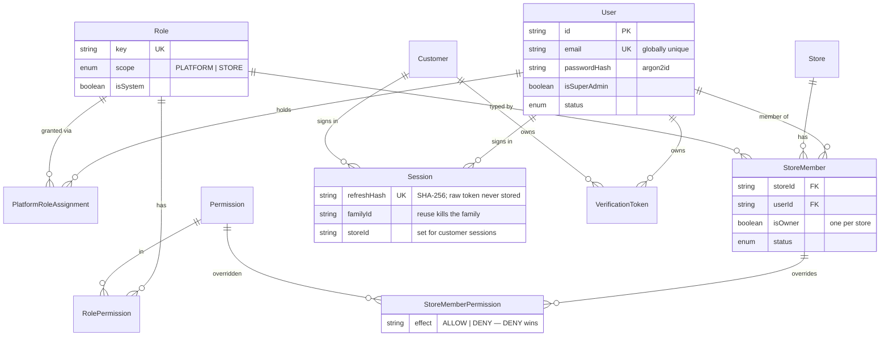
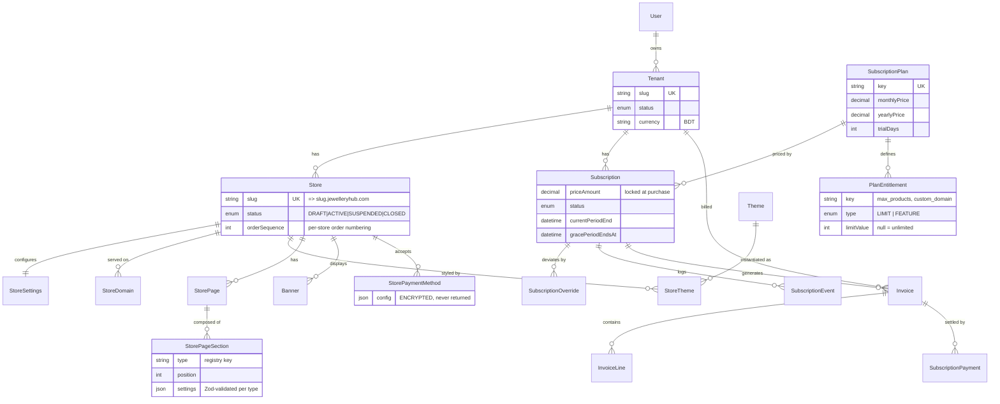
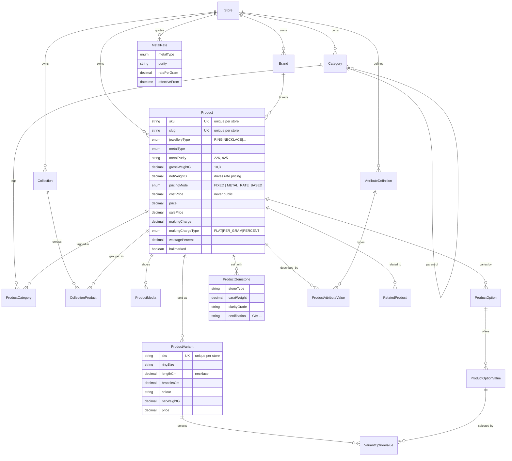
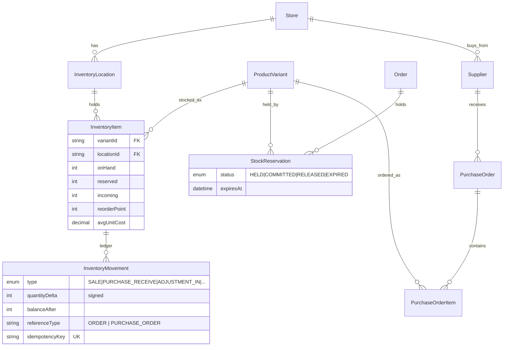
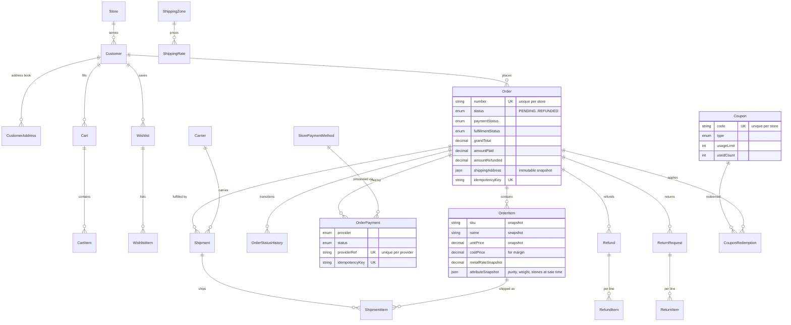
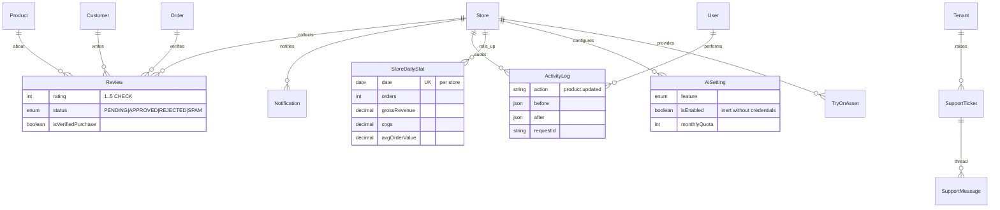

# Data Model and ER Diagrams — JewelleryHub

**Version** 0.1 (planning) · **Date** 2026-11-07
**Source of truth:** [prisma/schema.prisma](../prisma/schema.prisma) — 88 models,
47 enums, validated with `prisma validate`.

One 88-model diagram is unreadable, so the model is shown as six bounded
contexts. Attributes are trimmed to keys and the fields that carry a decision;
the schema file has the rest.

---

## 1. Identity and access



Two identity realms. `User.email` is globally unique (one login across every
store they work for). `Customer` is unique **per store** — the same shopper at
two stores is two rows, which is the isolation requirement, not an accident.

## 2. Tenancy, billing and storefront configuration



Three decisions worth defending:

- **Entitlements are rows.** Super Admin can introduce `max_staff` or
  `ai_descriptions` from the UI; adding a limit never needs a migration.
- **`Subscription.priceAmount` is a copy, not a lookup.** Raising a plan's
  price must not silently re-bill existing customers.
- **Section settings are JSON, section _types_ are code.** No-code layout
  editing without arbitrary HTML, and therefore without the XSS surface a
  free-form builder brings.

## 3. Jewellery catalogue



**Why `MetalRate` exists.** A gold retailer does not price per item; they price
`net weight × today's rate + making charge + wastage + stone value`. Without
this, every rate change means re-typing every price — the single biggest reason
a jeweller abandons a generic e-commerce platform. `pricingMode` keeps it
opt-in, so artificial-jewellery sellers are unaffected.

**Why weights are `DECIMAL(10,3)`.** 0.001 g precision. A float here is a
rounding dispute with a customer over a gold purchase.

## 4. Inventory



`(variantId, locationId)` is unique, so stock has exactly one home per
location. `available = onHand − reserved` is computed, never stored, so it
cannot drift. `InventoryMovement` is append-only with `balanceAfter`, which
makes "why is this 3 and not 4?" answerable from the ledger alone, and makes a
running balance reconcilable against `InventoryItem.onHand` in a nightly check.

Overselling is prevented by `SELECT ... FOR UPDATE` on the `InventoryItem` rows
inside the order transaction, plus a CHECK constraint
(`onHand >= 0`, `reserved >= 0`) as the backstop.

## 5. Commerce — cart to order to money



**Three status fields, not one.** An order can be `DELIVERED` + `PAID` +
`FULFILLED`, or `PROCESSING` + `UNPAID` (COD) + `UNFULFILLED`. Collapsing
these into one enum is the classic e-commerce modelling mistake; partial
shipment and partial refund become unrepresentable.

**Everything on `OrderItem` is a snapshot.** The order must render identically
in three years, after the product is archived, renamed, repriced or deleted.
`attributeSnapshot` captures the purity, net weight, making charge and stone
details that were sold — the jewellery equivalent of a warranty card, and the
basis for a return dispute.

**`OrderPayment.providerRef` is unique per provider.** A replayed webhook
collides on insert and is rejected by the database, independent of application
logic.

## 6. Operations — reviews, audit, support, analytics



`StoreDailyStat` and `PlatformDailyStat` exist so no dashboard query ever scans
`Order`. They are rebuilt idempotently from source data, so a bad rollup is
fixed by re-running the job rather than by repair SQL.

## 7. Conventions applied throughout

| Concern        | Rule                                                                                                                                                                                       |
| -------------- | ------------------------------------------------------------------------------------------------------------------------------------------------------------------------------------------ |
| Primary keys   | `cuid()` strings — opaque, URL-safe, no row-count leak through sequential ids                                                                                                              |
| Money          | `DECIMAL(14,2)`; floats banned in pricing code by lint rule                                                                                                                                |
| Weight         | `DECIMAL(10,3)` grams; carat `DECIMAL(10,3)`                                                                                                                                               |
| Percent / rate | `DECIMAL(6,3)`                                                                                                                                                                             |
| Tenant column  | Every tenant-owned table carries `storeId`, denormalised onto children, so one RLS predicate fits all                                                                                      |
| Uniqueness     | Tenant-scoped: `@@unique([storeId, slug])`, `([storeId, sku])`, `([storeId, code])`, `([storeId, number])`                                                                                 |
| Deletes        | `Restrict` / `SetNull`; catalogue and customers soft-delete via `deletedAt`; orders are never deleted                                                                                      |
| Timestamps     | `createdAt` + `updatedAt` on every mutable table; lifecycle timestamps (`confirmedAt`, `shippedAt`) rather than status-change guessing                                                     |
| Ledgers        | `InventoryMovement`, `ActivityLog`, `OrderStatusHistory`, `SubscriptionEvent`, `WebhookEvent` are append-only                                                                              |
| Idempotency    | Unique keys on `Order`, `OrderPayment`, `SubscriptionPayment`, `InventoryMovement`, `WebhookEvent`                                                                                         |
| JSON use       | Only for genuinely open shapes (section settings, address snapshots, provider payloads, settings groups) — never to avoid modelling a relationship. Each is Zod-validated at the boundary. |

## 8. Constraints that Prisma cannot express

These go in hand-edited migration SQL:

```sql
-- One owner per store
CREATE UNIQUE INDEX store_single_owner ON "StoreMember" ("storeId")
  WHERE "isOwner" = true AND "deletedAt" IS NULL;

-- One active theme per store
CREATE UNIQUE INDEX store_one_active_theme ON "StoreTheme" ("storeId")
  WHERE "isActive" = true;

-- One primary domain per store
CREATE UNIQUE INDEX store_one_primary_domain ON "StoreDomain" ("storeId")
  WHERE "isPrimary" = true;

-- Stock can never go negative
ALTER TABLE "InventoryItem"
  ADD CONSTRAINT inventory_non_negative CHECK ("onHand" >= 0 AND "reserved" >= 0);

-- Ratings in range
ALTER TABLE "Review" ADD CONSTRAINT review_rating_range CHECK (rating BETWEEN 1 AND 5);

-- Money sanity
ALTER TABLE "Order" ADD CONSTRAINT order_totals_non_negative
  CHECK ("grandTotal" >= 0 AND "amountPaid" >= 0 AND "amountRefunded" >= 0);
ALTER TABLE "Order" ADD CONSTRAINT order_refund_within_paid
  CHECK ("amountRefunded" <= "amountPaid");

-- Full-text search (per store, filtered in the query)
ALTER TABLE "Product" ADD COLUMN search_vector tsvector
  GENERATED ALWAYS AS (
    setweight(to_tsvector('simple', coalesce(name, '')), 'A') ||
    setweight(to_tsvector('simple', coalesce(sku, '')), 'B') ||
    setweight(to_tsvector('simple', coalesce("shortDescription", '')), 'C')
  ) STORED;
CREATE INDEX product_search_idx ON "Product" USING GIN (search_vector);
CREATE INDEX product_name_trgm_idx ON "Product" USING GIN (name gin_trgm_ops);

-- Row-level security, generated for every table with a storeId
-- (see docs/03-multi-tenancy.md §3, layer 4)
```

## 9. Seed data

`prisma/seed.ts` produces a working platform, with every value realistic rather
than placeholder:

1. Permission catalogue and system roles (`super_admin`, `support_agent`,
   `store_owner`, `store_manager`, `catalogue_staff`, `fulfilment_staff`).
2. Four plans with their entitlement rows (Starter / Growth / Business /
   Enterprise).
3. Three themes with default tokens and supported section types.
4. One Super Admin from environment variables — never a hardcoded password.
5. Demo tenant `aurum-jewellers` with ~40 jewellery products across rings,
   necklaces, earrings, bangles and bridal sets; variants with real ring sizes
   and chain lengths; gemstone rows; metal rates; stock; 25 customers;
   120 orders spread over 90 days in mixed states; reviews; coupons.
6. Second demo tenant `silver-leaf` with a different theme and overlapping
   SKUs and slugs — deliberately, as the isolation suite's fixture.

Demo data is gated behind `SEED_DEMO_DATA=true` and refuses to run when
`NODE_ENV=production`.
