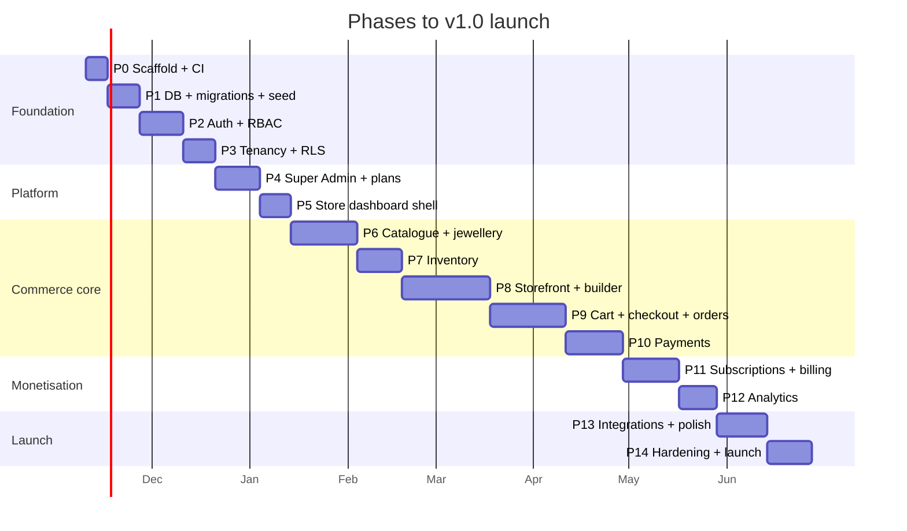

# Development Roadmap — JewelleryHub

**Version** 0.1 (planning) · **Date** 2026-11-07

Each phase is a vertical slice that ends in something demonstrable and tested.
Nothing is "done" until it has tests, migrations and a runbook entry.

**Estimates** assume one full-time senior developer working with me, roughly
4 productive days a week. Multiply down for a larger team, up for part-time.
The sequence matters more than the numbers: phases 1–3 are the foundation that
every later phase builds on, and shortcuts there are paid for repeatedly.

---

> **Note, 7 November 2026 — one phase taken out of order.** A read-only
> storefront slice (NestJS API + Next.js shop + host-based store routing) was
> built straight after Phase 1, ahead of authentication, so the platform could
> be seen working end to end against real rows. It covers FR-SF-01..05 and
> FR-CT-01..04 for reading only; nothing in it writes, and cart, checkout and
> the dashboard remain where this roadmap puts them. Phase 2 is unchanged and
> is next.

> **Note, 8 November 2026 — what is actually built, against this plan.**
> Phases 0–3 are complete and verified: `pnpm db:verify-rls` reports 33/33
> isolation checks passing, and `pnpm test` runs 126 tests.
>
> Of **Phase 4**, store provisioning is built — a Super Admin creates each shop
> with its owner and a one-time password, in one transaction. Plans, pricing
> and entitlement enforcement are not.
>
> Of **Phase 5**, the dashboard shell is built: a shop's own pages, resolved
> from its slug against the caller's memberships. Staff invites are not, because
> they need an email service.
>
> Of **Phase 6**, the first slice is built: a shop can list, search, filter,
> create, edit and archive its own products with the full jewellery field set
> (metal, purity, gross and net weight, hallmark, stones, making charge,
> wastage, VAT). Variants and sizes, gemstone rows, category and brand editing,
> and metal-rate-driven recalculation are not.
>
> **Phase 7 (inventory)** is untouched.
>
> Two gaps are credential-shaped rather than unfinished work. **Image upload**
> needs Cloudinary or S3; until one is configured the product editor accepts
> image addresses (`https://…`, or a path inside `apps/web/public`) and
> `catalogueMeta.mediaUploadEnabled` is `false`, which is what the UI reads to
> decide what to offer. **Password reset and staff invites** need an email
> service; `pnpm user:set-password` is the interim path. Neither has a stub
> that pretends to work.

## Milestone map

Roughly **~16 calendar weeks of focused work to a private beta** (end of P10),
**~22 weeks to commercial v1.0**. Phases 12–13 can overlap with a second
developer.

---

## Phase 0 — Scaffold and CI _(1 week)_

**Purpose** Make the repository boringly reliable before any feature lands.

**Prerequisites on this machine:** install pnpm (`npm i -g pnpm`) and either
Docker Desktop or a Neon account — neither Docker nor Postgres is present yet.

**Deliverables**

- pnpm workspace + Turborepo; `apps/api`, `apps/web`, `apps/worker`,
  `packages/{shared,ui,config,storefront-themes}`
- Strict TypeScript, ESLint (incl. the import-boundary and no-float-money
  rules), Prettier, Husky + lint-staged, Conventional Commits check
- `docker-compose.yml`: Postgres 16, Redis 7, Mailpit
- NestJS boots with typed config validated by Zod, health check, pino logging,
  Swagger at `/docs`; Next.js boots with Tailwind + Shadcn + the token palette
- GitHub Actions: lint → typecheck → unit → integration (service containers) →
  build; preview deploys
- `README.md` with real setup steps and `.env.example` for each app

**Exit** `pnpm dev` runs API + web + worker against local Postgres and Redis;
CI green on a trivial PR.

---

## Phase 1 — Database, migrations, seed _(1.5 weeks)_

**Purpose** Turn the approved schema into a real, seeded database.

**Depends on** P0, approved `prisma/schema.prisma`.

**Deliverables**

- Initial migration from the validated schema
- Hand-written migration SQL: partial unique indexes, CHECK constraints,
  `pg_trgm`, the generated `tsvector` column and GIN indexes
- `prisma/rls/generate.ts` → RLS policy migration for every `storeId` table;
  `app_runtime` (NOLOGIN bypass off) and `app_migrator` roles
- `prisma/seed.ts`: permissions, system roles, four plans with entitlements,
  three themes, Super Admin from env, and `SEED_DEMO_DATA` demo tenants
- Schema-guard test (every tenant model in `TENANT_OWNED` and under RLS)
- Query helpers: pagination, cursor pagination, soft-delete filters

**Exit** `prisma migrate reset` → seeded platform; RLS raw-SQL test passes with
the application bypassed.

---

## Phase 2 — Authentication and RBAC _(2 weeks)_

**Purpose** Identity before anything that needs protecting.

**Deliverables**

- Argon2id passwords, lockout, enumeration-safe responses
- EdDSA access tokens + rotating refresh with family revocation on reuse
- Cookie transport, CSRF double-submit, JWKS with key rotation
- Email verification, password reset, staff invite (single-use hashed tokens)
- Permission catalogue + system roles + member ALLOW/DENY overrides
- `AuthGuard`, `PermissionGuard`, `@RequirePermission`, and the **startup
  assertion that fails boot on an unguarded route**
- Transactional email via the mail adapter (Mailpit locally)
- Frontend: login, register, verify, reset, invite-accept; session helpers;
  protected layouts

**Exit** A user registers, verifies, logs in, is refreshed transparently, is
locked out appropriately; refresh-reuse revokes the family; an unguarded route
fails CI.

---

## Phase 3 — Multi-tenancy _(1.5 weeks)_

**Purpose** The property the whole product depends on, built once and proven.

**Deliverables**

- `TenantContext` on AsyncLocalStorage; `TenantGuard` for host, claim+header
  and platform paths
- Generated `TENANT_OWNED`; tenant-scoped Prisma extension; transaction helper
  issuing `SET LOCAL app.current_store_id`
- Store-by-host resolver with Redis cache and explicit invalidation
- Store provisioning transaction (user → tenant → store → settings → location →
  theme → home page → categories → trial subscription)
- Next middleware: host → surface routing, subdomain rewrite, reserved slugs
- Store switcher; `X-Store-Id` plumbing in the API client
- **The full isolation suite**: generated cross-tenant contract tests, raw-SQL
  RLS tests, unset-context fail-closed test, pool-bleed test, lint gates

**Exit** Two stores exist; the isolation suite passes; a deliberately
unscoped query is rejected both by lint and by the database.

---

## Phase 4 — Super Admin and plans _(2 weeks)_

**Deliverables** Platform dashboard with real rollups; store list/detail;
suspend/activate with reasons; plan and entitlement CRUD; subscription list
with manual plan change, trial extension and overrides; platform users and
roles; platform settings; audit log viewer; theme catalogue admin; the
`EntitlementGuard` with `@RequireFeature`/`@RequireLimit` and usage counting
inside the transaction; impersonation with banner and audit.

**Exit** A Super Admin creates a plan, assigns it, suspends a store (storefront
serves the suspended page), and a `max_products` limit blocks the API at the
boundary.

---

## Phase 5 — Store dashboard shell _(1.5 weeks)_

**Deliverables** The dashboard shell and every reusable primitive the next
eight phases consume: sidebar/topbar with permission-gated navigation, the
single `DataTable` (sort, filter, multi-select, pagination, column visibility,
empty + loading states), form patterns, chart wrappers, toast and confirm
dialog, skeletons, onboarding checklist, store profile and settings pages,
media upload with signed direct upload.

**Exit** An owner edits store settings, uploads a logo, and sees the onboarding
checklist advance. The design system is settled, so later phases add screens
rather than re-inventing components.

---

## Phase 6 — Jewellery catalogue _(3 weeks)_

**Deliverables** Categories (nested, reorderable), brands, collections (manual

- rules), custom attribute definitions; the product editor covering every
  jewellery field, gemstone rows, media gallery with reordering and video,
  options → variant generation, per-variant sizes/weights/prices; the pure
  pricing domain (making charge flat/per-gram/percent, wastage, metal-rate
  mode); metal rate management; bulk actions; CSV import/export with dry-run;
  full-text + trigram search; related products.

**Exit** A realistic 22K bangle with three sizes, two gemstone rows, five
images and rate-based pricing is created, searchable and correctly priced —
with the pricing maths covered by unit tests including rounding edges.

---

## Phase 7 — Inventory _(2 weeks)_

**Deliverables** Locations; levels per (variant, location); adjustments with
mandatory reasons; the append-only movement ledger with running balance;
reservation model with TTL and the sweep job; low-stock alerts and
notifications; suppliers; purchase orders with partial receiving and average
cost; stocktake; nightly reconciliation of ledger against levels; concurrency
tests proving no oversell under parallel load.

**Exit** 50 concurrent reservations on 1 unit yield exactly one success; the
ledger reconciles; receiving a PO updates stock and average cost.

---

## Phase 8 — Storefront and builder _(4 weeks)_

Largest phase; it is also the one a prospective customer judges you on.

**Deliverables** Three production themes (premium, minimal, bold), each
mobile-first and WCAG AA; token system → CSS variables; the section registry
with ten section types and validated settings; page/section CRUD with
drag-reorder and live preview; draft/publish with ISR tag revalidation;
banners; home, shop (full facet filtering: price, metal, purity, weight,
stone, custom attributes), category, collection, product (gallery with zoom,
variant picker, spec table, size guide, delivery estimate), search,
wishlist, static pages; customer account area; SEO (metadata, JSON-LD,
sitemap, robots, OG images); custom domain flow with verification.

**Exit** Two stores look genuinely different without a code change; LCP under
2.5 s on throttled 4G for home and product; Lighthouse ≥ 90 on
performance/accessibility/SEO.

---

## Phase 9 — Cart, checkout, orders _(3.5 weeks)_

**Deliverables** Cart with snapshots and price-change detection; cookie cart →
account merge; coupon engine (all four types, limits, scoping, concurrency-safe
redemption); shipping zones and rates with estimates; the checkout flow with
full server-side re-validation; the atomic order placement transaction
(reprice → reserve → redeem → number → snapshot → history) with idempotency;
the order state machine; order list/detail; shipments (partial supported);
cancellation with release/restock; returns; refunds (per-line, bounded by
amount paid); invoice and packing slip PDFs; order export; manual order
creation; guest tracking; the full transactional email set.

**Exit** A guest completes a COD order; stock reserves then commits; staff move
it to delivered; a partial refund restocks correctly and totals reconcile.

---

## Phase 10 — Payments _(2.5 weeks)_

**Deliverables** The `PaymentProvider` interface and capability model; COD,
SSLCommerz, bKash, Nagad adapters in sandbox and live modes; per-store
credential storage with envelope encryption; the webhook pipeline (capture →
signature verify → dedupe → independent provider verification → amount check →
transactional apply); the payment attempt ledger; retry and reconciliation
job; gateway refunds where supported; a Stripe adapter skeleton.

**Security tests that must pass before this phase closes**

- A forged success callback leaves payment status unchanged
- A replayed webhook applies exactly once
- A webhook whose amount differs from the order total is rejected and alerted
- Credentials never appear in any API response, log or error

**Exit** Private beta is possible: a sandbox SSLCommerz order reaches `PAID`
only through verified server-side confirmation.

---

## Phase 11 — Subscriptions and billing _(2.5 weeks)_

**Deliverables** Public pricing page from real plan data; subscribe monthly or
yearly; trial with the reminder sequence; upgrade with proration preview and
immediate effect; downgrade at period end with the usage precondition; renewal
job; dunning on failure → grace → suspend; cancel and resume; invoice
generation and PDF; payment history; usage meters against entitlements;
upgrade prompts at every limit; platform MRR/ARR rollups.

**Exit** A trial converts, renews, fails a renewal, dunning runs, the store
suspends, payment succeeds and it reactivates — all driven by the scheduler in
a time-travel test.

---

## Phase 12 — Analytics _(1.5 weeks)_

**Deliverables** Rollup jobs (hourly incremental, nightly full, idempotent and
re-runnable); store dashboard with range selection and period deltas; revenue
trend, best sellers, low stock; reports by day/month/product/category/payment
method, customer acquisition, inventory valuation, gross margin from
snapshotted cost; CSV export; platform analytics (MRR, ARR, plan mix, churn,
GMV); every chart on one accessible token palette.

**Exit** Dashboard figures reconcile exactly with the seeded orders; dashboard
p95 under 500 ms with 500k seeded orders.

---

## Phase 13 — Integrations and polish _(2 weeks)_

**Deliverables** Courier adapters (Pathao, Steadfast, RedX) with consignment
creation and tracking webhooks; SMS adapter; review moderation UI and rating
aggregation; in-app notification centre; support ticketing; AI configuration
surface with provider interfaces (inert without credentials) and the AI
description generator behind an entitlement; try-on data model plus the SDK
boundary; accessibility pass; empty-state and copy pass; bn locale scaffolding.

---

## Phase 14 — Hardening and launch _(2 weeks)_

**Deliverables** Load test (storefront browse, checkout, dashboard) to the
NFR-02 targets; k6 scripts committed; security review against the
`docs/06-auth-strategy.md` checklist; third-party penetration test focused on
tenancy and payments; backup restore rehearsal with a timed RTO; runbooks
(incident, failed payment reconciliation, stuck webhook, tenant data export,
restore); monitoring dashboards and alerts; staging soak with real-looking
traffic; legal pages; onboarding emails; production cutover with wildcard TLS.

**Launch gate** Every acceptance criterion in `docs/01-srs.md` §7 demonstrably
passing on staging, plus a green isolation suite and a clean restore drill.

---

## After v1.0

| Theme           | Items                                                                                     |
| --------------- | ----------------------------------------------------------------------------------------- |
| Growth          | abandoned-cart recovery, product bundles, gift cards, loyalty points, referrals           |
| Jewellery depth | gold exchange/buyback flows, EMI, repair orders, certificate verification, try-before-buy |
| Platform        | multi-storefront tenants, wholesale pricing tiers, marketplace discovery, app/plugin API  |
| International   | multi-currency, Stripe live, tax engines, en/bn/hi/ar locales                             |
| AI              | recommendations, shopping assistant, image enhancement, try-on SDK v1                     |
| Ops             | read replicas, search engine migration, regional CDN, SOC2 groundwork                     |

---

## Working agreement per phase

Before each phase I will state: its purpose, its dependencies, the exact files
to create or modify, and the test plan. After implementing, I will give you the
commands to run it, what you should see, and how it integrates with what
exists. No phase ships with mock data standing in for real functionality, and
no phase closes with a known failing test.
