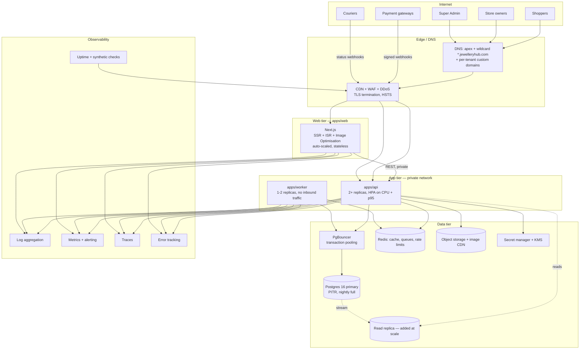

# Deployment Architecture — JewelleryHub

**Version** 0.1 (planning) · **Date** 2026-11-07

---

## 1. Topology



The API and worker are never publicly routable except for `/webhooks/*`, which
is exposed through the WAF with provider IP allowlists where the provider
publishes them.

## 2. Hosting recommendation

Two viable shapes. I recommend starting with (A) and keeping (B) as the exit.

### A. Managed, fastest to launch _(recommended for v1.0)_

| Component                 | Service                                                   | Why                                                                                                                                                                                  |
| ------------------------- | --------------------------------------------------------- | ------------------------------------------------------------------------------------------------------------------------------------------------------------------------------------ |
| `apps/web`                | **Vercel**                                                | Wildcard + custom domains with automatic TLS are a first-class feature, and per-tenant domains are otherwise the fiddliest part of this build. ISR and image optimisation come free. |
| `apps/api`, `apps/worker` | **Railway / Render / Fly.io** containers                  | Simple container deploys with private networking and autoscaling                                                                                                                     |
| Postgres                  | **Neon** (or managed PG)                                  | Branch-per-PR databases make preview environments honest; PITR built in                                                                                                              |
| Redis                     | **Upstash** or managed Redis                              | Cheap, fine for cache + BullMQ at this scale                                                                                                                                         |
| Objects                   | **Cloudinary**                                            | Jewellery needs aggressive, high-quality image transforms; Cloudinary does this better than raw S3 + a pipeline                                                                      |
| Email                     | **Resend** (dev/early) → **SES** (volume)                 | Behind one adapter either way                                                                                                                                                        |
| Secrets                   | Platform secret store + a KMS key for envelope encryption |                                                                                                                                                                                      |

Rough running cost at launch (~50 stores): **$150–300/month**, dominated by
Postgres and Cloudinary.

### B. Portable, for scale or data-residency requirements

Kubernetes (EKS/GKE) or AWS ECS + RDS Postgres + ElastiCache + S3 +
CloudFront + ALB. More control and cheaper per unit at scale; weeks more
platform work, and custom-domain TLS becomes yours to solve (cert-manager with
a DNS-01 solver, or ACM with per-domain validation).

Everything in `apps/api` and `apps/worker` is a plain container reading
configuration from the environment, so (A) → (B) is a deployment change rather
than a rewrite. That portability is the reason not to put business logic in
Next.js Route Handlers.

## 3. Environments

|                  | local              | preview                           | staging                       | production                      |
| ---------------- | ------------------ | --------------------------------- | ----------------------------- | ------------------------------- |
| Trigger          | `pnpm dev`         | every PR                          | merge to `main`               | tagged release, manual approval |
| Database         | Docker Postgres    | Neon branch, auto-deleted         | own DB, anonymised copy       | primary + PITR                  |
| Redis            | Docker             | shared, key-prefixed              | own                           | own                             |
| Payments         | mock provider      | mock provider                     | real **sandbox** credentials  | live                            |
| Email            | Mailpit            | Mailpit                           | real provider, sandbox domain | live                            |
| Domains          | `*.localhost:3000` | `pr-123.preview.jewelleryhub.dev` | `*.staging.jewelleryhub.com`  | `*.jewelleryhub.com`            |
| Seed             | full demo          | full demo                         | anonymised production-shaped  | migrations only                 |
| `SEED_DEMO_DATA` | true               | true                              | false                         | **refuses to run**              |

`*.localhost` resolves to 127.0.0.1 in Chrome, Firefox and Safari without a
hosts-file entry, so subdomain multi-tenancy is testable locally with no setup.

## 4. Pipeline

```
PR opened
  └─ quality · unit · integration · migrate-check · contracts · security · build
  └─ preview deploy (web + api + Neon branch + migrate + seed)
  └─ e2e against the preview
Merge to main
  └─ build + push images (tagged with the commit sha)
  └─ deploy staging → migrate → smoke tests → e2e
Tag v*.*.*
  └─ manual approval
  └─ migrate production (expand phase only)
  └─ rolling deploy API (maxSurge 1, maxUnavailable 0), health-gated
  └─ deploy web
  └─ deploy worker
  └─ smoke tests → auto-rollback on failure
  └─ contract phase of the migration, next release
```

### Migration discipline

Zero-downtime means migrations are **expand/contract**, always:

1. **Expand** — add the nullable column / new table / new index
   (`CREATE INDEX CONCURRENTLY`). Deployed before the code that uses it.
2. **Backfill** — a resumable, batched worker job; never a long-running
   migration transaction.
3. **Switch** — the new code reads and writes the new shape.
4. **Contract** — a later release drops the old column.

Never in a single release: rename a column, add a `NOT NULL` without a default,
or drop anything the previous version still reads. `migrate-check` in CI
applies migrations from the previous release tag to catch exactly this.

Rollback: application images roll back freely because migrations are
backward-compatible by construction. A migration is never rolled back; a
forward fix is written instead.

## 5. Custom domains

```
Owner adds www.brand.com
  → API creates StoreDomain (sslStatus: NONE)
  → UI shows: CNAME www → cname.jewelleryhub.com
              TXT  _jh-verify.www → <token>
  → cron (15 min) resolves the TXT; on match sets verifiedAt
  → request a certificate (Vercel domains API / ACM / cert-manager)
  → poll until ISSUED; optionally set as primary and 301 the subdomain
```

Unverified hostnames never resolve to a store. Verification and issuance are
retried with backoff and surfaced in the dashboard with the actual DNS error,
because "it doesn't work" is the single most common support ticket in this
feature.

## 6. Configuration and secrets

- Every variable is declared in a Zod config schema and validated at boot; the
  process **exits** on a missing or malformed value rather than failing later
  under load. The full list is in `docs/11-env-reference.md`.
- Secrets come only from the platform secret store, injected as environment
  variables. Nothing secret is committed, and `gitleaks` runs in CI and as a
  pre-commit hook.
- Per-store gateway credentials are envelope-encrypted: a KMS-held master key
  wraps a data key, the data key encrypts the config blob. Decryption happens
  only inside the payment service.
- Key rotation: JWT signing keys quarterly with a JWKS overlap window;
  database credentials half-yearly; the KMS master key annually with
  re-wrapping, never re-encrypting plaintext at rest.

## 7. Scaling plan

| Signal                     | Action                                                               |
| -------------------------- | -------------------------------------------------------------------- |
| API p95 > 500 ms sustained | scale out replicas (stateless)                                       |
| DB CPU > 70 %              | add a read replica; route storefront reads to it                     |
| Connection saturation      | raise PgBouncer pool, lower Prisma `connection_limit` per replica    |
| Cache hit rate < 80 %      | review keys and TTLs; pre-warm popular catalogue pages               |
| Search p95 > 700 ms        | move from Postgres FTS to Meilisearch behind the existing interface  |
| Queue depth growing        | scale worker replicas; split queues by priority                      |
| One tenant dominating load | per-store rate limits; consider a dedicated database for that tenant |
| `Order` table growth       | partition by `placedAt` (monthly), archive beyond 24 months          |

Nothing here needs an architectural change, which was the point of the shared
schema plus a single enforcement point.

## 8. Backup and disaster recovery

| Property       | Target                                                        |
| -------------- | ------------------------------------------------------------- |
| RPO            | 5 minutes (continuous WAL archiving)                          |
| RTO            | 1 hour (rehearsed)                                            |
| Full backups   | nightly, 30-day retention, encrypted                          |
| PITR window    | 7 days                                                        |
| Object storage | versioning on, lifecycle to cold after 90 days                |
| Restore drill  | quarterly, timed, into a scratch environment, result recorded |

Per-tenant export (`GET /platform/stores/{id}/export`) produces a JSON + CSV
archive for a single store — needed both for GDPR-style requests and for
offboarding a tenant who leaves. A whole-database restore is never used to
recover one tenant's data; a separate, audited code path handles that.

## 9. Observability and alerting

**Logs** — pino JSON with `requestId`, `storeId`, `userId`, `route`,
`durationMs`; PII redacted by a serialiser. Correlated across web → api →
worker by the request id.

**Metrics** — RED per route (rate, errors, duration); business metrics
(orders/min, checkout conversion, payment success rate by provider, queue
depth and age, reservation expiries, MRR).

**Traces** — OpenTelemetry spans across HTTP → service → Prisma → gateway, so
a slow checkout is attributable rather than guessed at.

**Alerts** (paging in bold):

- **5xx rate > 1 % for 5 min**
- **Payment success rate drops > 20 % for a provider** (gateway outage)
- **Webhook processing failures > 5 in 10 min** (silent revenue loss)
- **Checkout error rate > 2 %**
- Database CPU > 85 %, connections > 90 %, replication lag > 30 s
- Queue oldest-job age > 10 min
- Any `BYPASSRLS` role connection
- Any 403 `STORE_MISMATCH` spike (probing or a bug)
- Certificate expiry < 14 days; domain verification stuck > 24 h
- Disk > 80 %; backup job failed; restore drill overdue

Synthetic checks every minute: marketing homepage, a storefront product page,
`/health`, and a scripted add-to-cart.

## 10. Runbooks to write in Phase 14

`docs/runbooks/` — incident response; payment reconciliation (gateway says paid,
we do not); stuck or replayed webhook; order stuck in `AWAITING_PAYMENT`;
inventory ledger mismatch; tenant data export; tenant offboarding; database
restore; failover; rotating a leaked secret; suspending a tenant for abuse.

Each runbook: symptom → how to confirm → immediate mitigation → root-cause
query → follow-up. Written by whoever builds the feature, while they still
remember how it fails.
